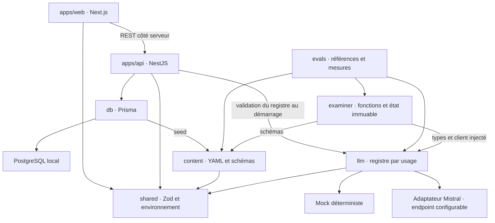

# Architecture des fondations

## Modules et dépendances

Les dépendances ne remontent jamais des packages vers les apps. ESLint bloque ces
imports et les dépendances des trois modules centraux aux frameworks ou à Prisma.
L’examinateur interdit également les imports Node et `fetch` directs. Les fonctions
orchestrent le client injecté ; à entrées et réponses du client identiques, elles
produisent le même résultat sans modifier l’état fourni.

Les packages internes exposent leur source TypeScript dans le workspace. `tsx` exécute
les scripts et NestJS ; Next transpile `shared`. Les builds des packages produisent
également `dist` pour vérifier l’émission. Ce ne sont pas des packages publiables ni
une stratégie de déploiement. TypeScript strict vérifie aussi les tests.

## Tranche verticale réellement raccordée

`GET /health` exécute `SELECT 1` et renvoie 503 avec un message générique en cas d’échec.
`GET /skills` interroge PostgreSQL et valide sa réponse avec le schéma Zod partagé.
Les paramètres de requête inattendus sont rejetés. La documentation `/docs` et
`/openapi.json` est générée avec Swagger ; le contrat skills vient du même schéma Zod.
La page française effectue une requête serveur sans cache et affiche les prérequis.
Un message externalisé indique une indisponibilité. Aucun navigateur n’accède à la base.
Les dictionnaires français et anglais existent, sans routage multilingue pour l’instant.

## Flux d’un oral

Le flux suivant est exécuté par les tests et le banc, pas exposé par une route :

1. Charger le défi et la grille versionnés, recevoir le travail et un horodatage.
2. Injecter le client `examiner` choisi par le registre ; préparer deux questions
   fondées sur le défi, la grille et la soumission.
3. Ajouter une réponse validée, demander une relance contextualisée et retourner un
   nouvel état. Refuser les tours supplémentaires, le retour dans le temps et le changement de modèle.
4. Noter après deux réponses. Valider le JSON, l’exhaustivité et l’unicité des critères,
   leurs bornes, les justifications et la cohérence du verdict avec le seuil de la grille.
5. Une future couche applicative persistera état, tours et validation, décidera de la
   durée de validité et enregistrera la consommation de quota dans une transaction.

Le prompt traite le code et la transcription comme des données non fiables. Ce garde-fou
n’est pas une démonstration de résistance aux injections. Il n’y a ici ni chronomètre,
ni exécution de code soumis, ni injection de bug, ni vocal, ni contrôle anti-assistance.
Le positionnement, les règles de renouvellement et la durée d’expiration restent à définir.
Les interfaces `SpeechToText` et `TextToSpeech` sont vides, sans implémentation.

## LLM et évaluations

`LlmClient` expose texte, objet validé par Zod et streaming. Les usages `examiner`,
`tutor` et `content-generation` choisissent chacun `mock` ou `mistral` et un modèle.
L’URL de base et la clé sont configurables ; un endpoint européen compatible peut
remplacer le service sans modifier l’examinateur. Un protocole différent nécessite
uniquement un nouvel adaptateur. Le choix technique ne garantit pas à lui seul une résidence européenne.

L’adaptateur réel utilise l’API de chat Mistral, les schémas JSON et SSE via `fetch`,
avec un délai maximal de 30 secondes et sans reprise automatique. Les tokens proviennent
du fournisseur ; s’ils sont absents, tokens et coût sont `null`, pas un zéro trompeur.
Les tarifs sont renseignés par usage et le coût est une estimation, sans gestion des
remises, caches ou taxes. Le mock émet zéro token facturable.

Chaque appel journalise usage, modèle, durée, tokens, coût estimé et statut ; jamais
prompts, réponses, identités ni corps d’erreur du fournisseur. Les erreurs propagées
par le client sont génériques. Le streaming gère les fragments UTF-8/SSE et l’annulation.
Les tests utilisent le mock ; les tests de contrat de l’adaptateur simulent HTTP.
La CI et l’environnement de test refusent les fournisseurs réels dans le registre.
`pnpm evals` force le mock, même si `.env` contient une configuration réelle.

Deux fichiers décrivent soumission, transcription et note attendue par critère.
Ils sont **illustratifs, avec `humanReview: pending`** : aucune validation humaine
n’est prétendue. Le mock reconnaît des signaux synthétiques documentés, il ne juge pas
la compréhension. Le banc conserve les questions de la transcription pour ne pas
associer une réponse de référence à une question régénérée différente. Il appelle
la notation trois fois et mesure erreur absolue par critère, écart-type, amplitude,
accord sur le verdict et stabilité. La commande mock échoue si son résultat attendu change.
`pnpm evals:live` est manuelle, nécessite une configuration réelle explicite et affiche
les mêmes mesures ; aucun seuil de qualité humaine n’est encore calibré.

## Modèle de données

| Entité                    | Rôle et invariants                                                           |
| ------------------------- | ---------------------------------------------------------------------------- |
| User                      | Identifiant, email, date de création ; aucun mécanisme d’authentification    |
| Skill / SkillPrerequisite | Projection de l’arbre YAML, référence RNCP optionnelle                       |
| Challenge                 | Famille, consigne, grille et empreinte du contenu synchronisé                |
| Attempt                   | Travail soumis et copie du défi à la tentative                               |
| OralSession               | Propriétaire, tentative, mode, fournisseur/modèle, grille figée, début/fin   |
| OralTurn                  | Locuteur, texte, modèle éventuel, horodatage et séquence unique par session  |
| Validation                | Verdict, détail JSON par critère, compétence, dates de validation/expiration |
| OralUsage                 | Une consommation unique par session, utilisateur et date pour les quotas     |

Les clés étrangères composites imposent le même propriétaire à la tentative, à la
session, à la validation et à la consommation. Des contraintes SQL imposent les dates
cohérentes, les séquences positives et l’absence de prérequis sur soi-même. Les cycles
complets sont vérifiés lors du chargement du contenu. L’appartenance de la compétence
validée au défi et la forme des snapshots/notes devront être validées par la future
transaction métier ; aucun endpoint d’écriture ne permet aujourd’hui de les contourner.

Une compétence peut avoir plusieurs validations historiques. Une validation courante
doit être `PASSED` et non expirée ; la politique entre validations successives reste
à préciser. `countConsumedOrals` compte sur `[début, fin[`, sans cumul stocké susceptible
de dériver. L’application future devra réserver le quota de façon atomique pour éviter
les courses ; seul le modèle et la lecture du compteur sont livrés.

Le seed charge tous les fichiers et valide le graphe avant la transaction. Il met à jour
les identifiants existants et remplace leurs arêtes, sans duplication. Il ne supprime
pas automatiquement les nœuds ou défis retirés des fichiers : conserver les références
historiques nécessite une décision explicite d’archivage. L’empreinte et les snapshots
rendent les changements auditables. Le contenu pédagogique est édité dans Git.

## Configuration et données personnelles

`.env.example` fournit seulement les valeurs de développement. `pnpm install` en copie
le contenu dans `.env` si nécessaire ; ce fichier est ignoré par Git. Les variables du
processus priment. Les schémas Zod vérifient au démarrage la base, le port, l’URL API et
les fournisseurs/modèles/tarifs nécessaires. Une erreur liste les champs, pas leurs valeurs.
Prisma peut générer son client sans connexion ; les migrations exigent une URL valide.

En local, PostgreSQL tourne dans Docker avec un volume nommé `postgres_data`, accessible
sur la boucle locale au port 54329. Les apps écoutent sur la boucle locale également.
Les emails, soumissions, transcriptions, notes, dates et consommations restent dans cette
base. Git contient seulement du contenu et des exemples synthétiques.

Un appel à un modèle réel transmet consigne, grille, travail et tours nécessaires à
l’opération ; il ne transmet pas l’email ni l’identifiant utilisateur. Le travail libre
peut lui-même contenir des données personnelles : le minimiser avant tout usage réel.
Aucun contenu d’échange n’est enregistré par les logs LLM. Les logs Nest de ces routes
ne consignent pas les corps de requête. Le mock ne transmet rien à l’extérieur.

`deleteUserData` supprime l’utilisateur ; les cascades PostgreSQL effacent atomiquement
tentatives, sessions, tours, validations et consommations. Le test d’intégration vérifie
chaque table. Le contenu partagé demeure. Il n’existe pas encore de route publique de
suppression : elle dépendra de l’authentification et de l’autorisation futures.
La suppression en base n’efface pas d’éventuelles sauvegardes ou copies détenues par
un fournisseur. Avant des données réelles, définir et documenter durées de conservation,
purge et rotation des sauvegardes, accès, hébergement et conditions du fournisseur.
Aucune conformité réglementaire ni politique de rétention opérationnelle n’est revendiquée.

## Limites assumées

La fondation prouve les branchements et les invariants mécaniques. Elle n’expose pas
l’oral au web et ne permet pas d’apprendre ou de certifier une compétence en production.
Les choix structurants sont consignés dans les ADR. Le fournisseur réel n’est testé
qu’au niveau du contrat HTTP simulé ; un essai manuel sur données synthétiques reste requis.
