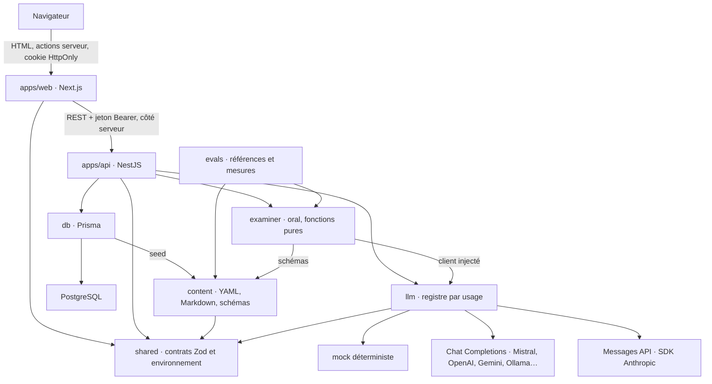

# Architecture

## Modules et dépendances

Les dépendances ne remontent jamais des packages vers les apps. ESLint bloque ces imports et
les dépendances de `examiner`, `llm` et `content` aux frameworks ou à Prisma. L’examinateur
n’importe ni module Node ni `fetch` : à entrées et réponses du client identiques, il produit
le même résultat sans modifier l’état fourni. Les décisions structurantes sont dans `adr/`.

Les packages exposent leur source TypeScript ; `tsx` exécute l’API et les scripts, Next
transpile `shared`. Le chargement du fichier `.env` vit dans `@kompri/shared/load-env`, que le
code exécuté par Next n’importe jamais (sinon le bundler copierait `.env` dans le build).

## Contenu

`packages/content/data` est la source de vérité, éditée dans Git (voir
[le guide de rédaction](content-guide.md)) :

- `domains.yaml` et `skills.yaml` décrivent l’arbre, ses prérequis et le statut
  `draft`/`published` de chaque compétence ;
- `skills/<id>/lessons/NN-slug.md` contient les leçons, avec un en-tête YAML ;
- `skills/<id>/challenges.yaml` contient les défis, leurs notes d’examinateur et leurs grilles.

`pnpm content:validate` vérifie schémas, références, cycles, complétude des compétences
publiées (deux leçons au moins, une famille de défi de chaque sorte) et le dialecte Markdown
rendu par le web (langages des blocs de code, encadrés `:::`, pas de HTML brut). Le seed
projette ce contenu dans PostgreSQL ; un élément retiré des fichiers est archivé
(`archivedAt`), jamais supprimé, pour que tentatives et validations gardent leurs références.
Les leçons Markdown sont exclues de Prettier, qui altérerait encadrés et exemples volontairement
fautifs.

## Parcours de l’apprenant

1. Le visiteur parcourt l’arbre et lit les leçons sans compte. Connecté, il voit l’état de
   chaque compétence : validée, à renouveler, disponible, verrouillée ou à venir.
2. Sur un défi, il soumet son travail (tentative). La tentative fige une copie du défi, des
   notes d’examinateur et de la grille.
3. Il démarre l’oral d’une tentative si la compétence est publiée, si chaque prérequis a été
   validé au moins une fois, s’il n’a pas d’autre oral en cours et s’il lui reste du quota.
   L’examinateur prépare les questions avant que la réservation du quota soit faite dans une
   transaction verrouillée par utilisateur ; un index unique partiel garantit un seul oral
   actif.
4. Chaque question a une échéance (`ORAL_ANSWER_SECONDS`). Une réponse vide ou arrivée après
   l’échéance (plus 15 s de tolérance réseau) est enregistrée comme absente et l’oral passe à
   la question suivante. Le navigateur affiche un minuteur, bloque le collage et envoie le
   brouillon à zéro. L’apprenant peut abandonner : les questions restantes sont absentes.
5. Après la dernière réponse, la notation est tentée trois fois au plus. Un échec laisse
   l’oral en `GRADING_FAILED`, relançable sans nouveau quota. Une réussite crée une validation
   qui expire après `VALIDATION_DAYS`. Le résultat détaille chaque critère et un retour écrit.
6. Pour retenter, l’apprenant soumet une nouvelle tentative : un oral par tentative.

Le tuteur IA répond aux questions sur une leçon, en streaming. Il est soumis à un quota
(`TutorUsage`, sans contenu) et refusé tant qu’un oral est en cours.

## Examinateur

`prepareOral`, `answerOral`, `abandonOral` et `gradeOral` reçoivent un état et un client LLM,
et retournent un nouvel état. Les prompts (`packages/examiner/src/prompts.ts`) transmettent
consigne, grille par niveaux, notes d’examinateur et travail comme données JSON non fiables.
Le JSON de notation est validé : chaque critère une fois, scores dans les bornes,
justification, verdict cohérent avec le seuil. Un modèle qui change pendant un oral est
refusé.

Le banc (`pnpm evals`) rejoue des oraux de référence avec le mock et mesure erreur absolue,
écart-type, amplitude et accord sur le verdict ; il échoue si le résultat attendu change.
Les références sont `humanReview: pending` : elles ne mesurent pas une fiabilité humaine.
`pnpm evals:live` rejoue les mêmes références avec le fournisseur configuré, à la demande.

## LLM

`LlmClient` expose texte, objet validé par Zod et streaming. Chaque usage (`examiner`,
`tutor`, `content-generation`) choisit son fournisseur et son modèle (voir
[l’ADR 007](adr/007-llm-providers.md) et `.env.example`). Les sorties structurées utilisent un
JSON Schema strict commun, revérifié par Zod. Chaque appel journalise usage, modèle, durée,
tokens, coût estimé et statut ; jamais prompts, réponses, identités ni corps d’erreur. La CI et
l’environnement de test refusent tout fournisseur réel ; les adaptateurs sont testés avec un
transport simulé.

## Web et sécurité

Le navigateur ne parle qu’au serveur Next. Les pages sont des composants serveur qui appellent
l’API ; les mutations passent par des actions serveur (vérification d’origine intégrée à
Next) ou des route handlers qui contrôlent l’origine. Le jeton de session (256 bits aléatoires,
stocké en base sous forme de condensat SHA-256) vit dans le cookie `kompri_session`
(`HttpOnly`, `SameSite=Lax`, `Secure` en production) et est transmis à l’API en `Bearer`.

L’API valide chaque entrée avec Zod, répond avec des erreurs `{statusCode, code, message}` sans
valeur reçue ni détail interne, et vérifie l’appartenance de chaque tentative et de chaque oral.
Les mots de passe sont hachés avec scrypt (N = 2^17, r = 8, p = 1) ; un compte est verrouillé
15 minutes après 5 échecs ; un compte inconnu coûte le même temps qu’un mot de passe faux.
En production, le web envoie CSP, HSTS et les en-têtes anti-cadrage et anti-reniflage.

## Modèle de données

| Entité                | Rôle et invariants                                                       |
| --------------------- | ------------------------------------------------------------------------ |
| User, AuthSession     | Compte, condensat du mot de passe, verrouillage ; sessions par condensat |
| Domain, Skill, Lesson | Projection du contenu ; statut, position, archivage                      |
| SkillPrerequisite     | Arêtes de l’arbre ; pas de prérequis sur soi-même                        |
| Challenge             | Défi, notes d’examinateur, grille figée, empreinte du contenu            |
| Attempt               | Travail soumis et copie du défi au moment de la tentative                |
| OralSession           | Plan de questions, échéance, statut, verdict et notation                 |
| OralTurn              | Tour numéroté, unique par session et séquence                            |
| Validation            | Compétence validée, critères, dates de validation et d’expiration        |
| OralUsage, TutorUsage | Consommations datées pour les quotas, sans contenu                       |

Des clés étrangères composites imposent le même propriétaire à la tentative, à l’oral, à la
validation et à la consommation. La suppression d’un compte efface atomiquement, par cascade,
sessions, tentatives, oraux, tours, validations et consommations ; le test d’intégration vérifie
les tables. Une migration appliquée n’est jamais réécrite.

## Données personnelles

Un appel à un modèle réel transmet consigne, grille, notes, travail et tours de l’oral, ou
la leçon et la question pour le tuteur ; jamais l’email ni l’identifiant. Le travail libre
peut contenir des données personnelles : la page de confidentialité invite à ne pas en mettre.
L’export (`GET /me/export`) fournit profil, tentatives, oraux, tours et validations en JSON.
La suppression en base n’efface pas les sauvegardes ni les copies détenues par un fournisseur :
leur conservation doit être définie avant l’ouverture au public (voir
[le guide d’exploitation](deploiement.md)).

## Limites assumées

La qualité pédagogique d’un modèle n’est pas démontrée par les tests ni par le mock : elle doit
être mesurée sur des oraux de référence relus par des humains. Il n’y a ni exécution du code
soumis, ni vocal, ni positionnement pour l’instant ; le contrôle anti-assistance repose sur le
minuteur, le blocage du collage et la coupure du tuteur, pas sur une surveillance.
